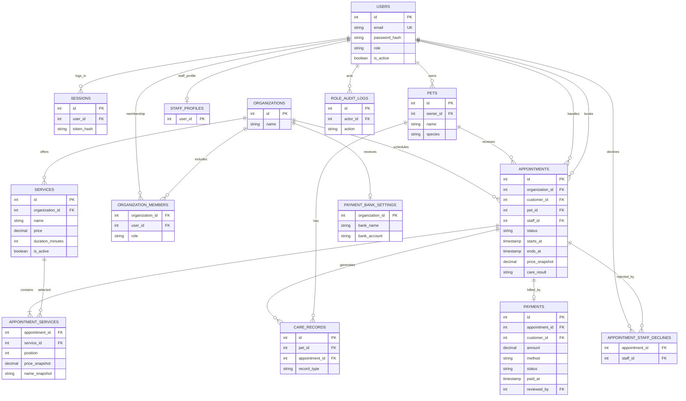

# PawCare ERD — single-store demo

This is the current logical model after migrations `001`–`013`. The physical database still stores `organization_id` foreign keys from the historical schema, but the live application operates **one store** with **Customer, Staff, Admin** only. Historical migration `003_owner_multitenant.sql` must not be deleted: later migrations depend on it.

**Booking lifecycle:** `pending → confirmed → in_progress → completed`, with allowed cancellations. The backend stores the combined service price/duration snapshot so subsequent catalog edits do not change old orders. A completed appointment creates a linked care record.

**Payment lifecycle:** Cash begins `unpaid`; bank transfer begins `awaiting_payment`, then `pending_review` after Customer notification. Authorized Staff or Admin can confirm `paid` (bank confirmation is **demo-only**). Cancellation may create `void` or `refund_required`; Admin records `refunded` when settled. The payment does not become paid merely because a service completes.

**Database history:** Physical tables such as `invitations` may exist from earlier migrations even though their feature/API routes have been retired. Do not drop migration history or historical tables simply to make the code tree shorter.
