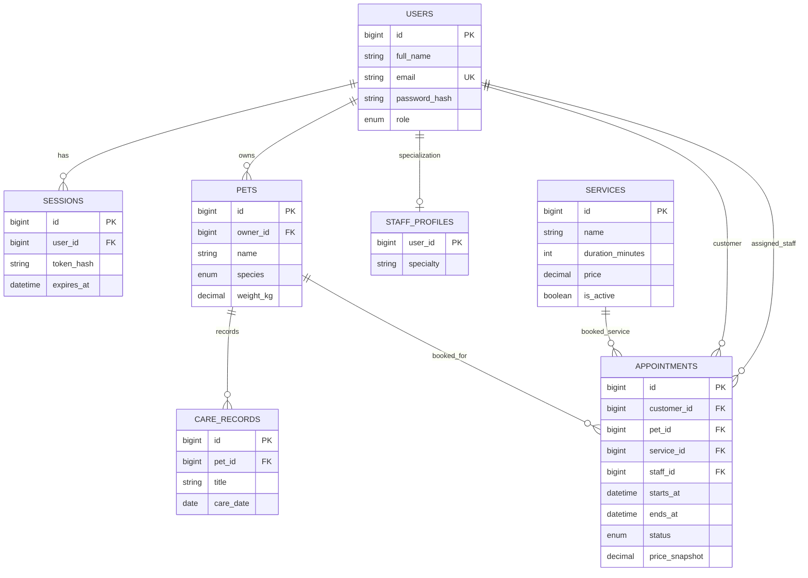

> **Lưu ý:** Sơ đồ/phần chức năng dưới đây là bản nguyên gốc từ ứng dụng một cửa hàng. Với phiên bản SaaS Owner, xem `infra/003_owner_multitenant.sql`, `README.md` và `docs/DEPLOY_RAILWAY.md` để có cấu trúc chính xác hiện hành.

> **Bản PostgreSQL:** DDL thực tế nằm ở `infra/001_postgres_schema.sql`.

# ERD — PawCare

Mô hình chuẩn hóa; `price_snapshot` bảo toàn doanh thu lịch sử khi giá dịch vụ thay đổi. Bảng sessions lưu **SHA-256 token hash** thay vì token gốc; hết hạn sau 7 ngày. Múi giờ nghiệp vụ Asia/Ho_Chi_Minh (08:00–18:00, thứ Hai–Bảy), `TIMESTAMPTZ` trong PostgreSQL lưu thời điểm chuẩn UTC.
