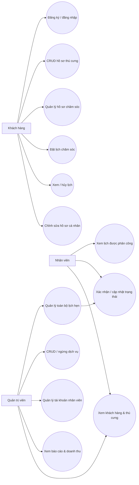

> **Lưu ý:** Sơ đồ/phần chức năng dưới đây là bản nguyên gốc từ ứng dụng một cửa hàng. Với phiên bản SaaS Owner, xem `infra/003_owner_multitenant.sql`, `README.md` và `docs/DEPLOY_RENDER_NEON_FREE.md` để có cấu trúc chính xác hiện hành.

# Use Case — PawCare

## Quy tắc phân quyền

| Chức năng | Khách hàng | Nhân viên | Admin |
|---|---|---|---|
| Xem/sửa thú cưng của chính mình | Có | Xem hồ sơ | Xem hồ sơ |
| Đặt/hủy lịch | Lịch của mình | Lịch do mình phụ trách | Toàn hệ thống |
| Cập nhật trạng thái | Chỉ hủy khi cho phép | Lịch được phân công | Tất cả |
| Danh sách khách hàng | Không | Có | Có |
| Thêm/sửa dịch vụ, nhân viên | Không | Không | Có |
| Dashboard doanh thu | Không | Lịch nhân viên | Toàn hệ thống |
