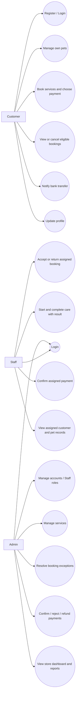

# PawCare — Use cases (single store)

This document describes the current **Admin, Staff, Customer** demo. There is no platform Owner, invitation-link workflow or multi-store switching.

## Main workflow

1. Customer registers, creates a pet and selects 1–8 services, day/time, optional preferred Staff and payment method.
2. API checks booking capacity, reserves the time and creates a pending booking plus unpaid/awaiting-payment payment record.
3. Staff accepts a targeted request or a common-queue booking. A declined booking returns to the queue; Admin handles exceptional cases.
4. Staff starts the service and records the result when completing it. A care record is created for the pet.
5. Payment state is separate from service completion. Assigned Staff or Admin confirms collected cash, or marks a bank transfer **as confirmed in demo only** after Customer notification. Admin handles rejected transfers and refunds.
6. Customer can see booking/payment outcomes; Admin sees store-wide reports.

## Permission summary

| Action | Customer | Staff | Admin |
|---|---|---|---|
| Manage own pet and booking | Yes | View assigned records | View and intervene |
| Accept, start, complete assigned booking | No | Yes | Handle exceptions (not perform Staff completion) |
| Confirm cash / bank demo payment | No | Assigned accepted booking only | Yes |
| Reject bank transfer / mark refund | No | No | Yes |
| Manage accounts and Staff roles | No | No | Yes |
| Configure bank recipient / services | No | No | Yes |
| View dashboard | Own activity | Assigned activity | Entire store |

Booking state: `pending → confirmed → in_progress → completed`, with permitted cancellation. Payment state: `unpaid / awaiting_payment → pending_review / paid`, with `void`, `refund_required`, `refunded` as applicable. Bank confirmation does not prove funds arrived.
