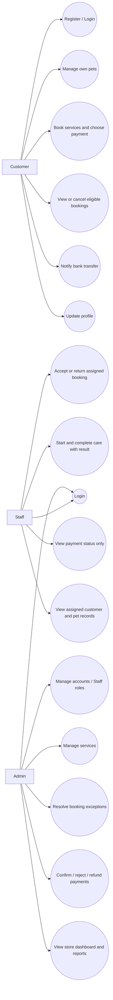

# PawCare — Use cases (single store)

This document describes the current **Admin, Staff, Customer** demo. There is no platform Owner, invitation-link workflow or multi-store switching.

## Main workflow

1. Customer registers, creates a pet and selects one or more services within the duration and opening-hours constraints, day/time and payment method; the Customer does not assign Staff.
2. API checks booking capacity, reserves the time and creates a pending booking plus unpaid/awaiting-payment payment record.
3. Admin assigns Staff to each pending booking. Only the assigned Staff may accept it; a declined booking returns to Admin for reassignment. There is no open Staff queue.
4. Staff starts the service and records the result when completing it. A care record is created for the pet.
5. From appointment details, Admin can view the pet's profile and care history. Staff can view this information only for an accepted appointment assigned to them. The modal is read-only and uses the existing permission-checked pet API.
6. Payment state is separate from service completion. Only Admin confirms cash collected or marks bank transfer **as confirmed in demo only** after Customer notification, and handles rejected transfers. Refund processing is not available in PawCare; bookings already paid or awaiting review cannot be cancelled within the application. Staff only views payment status for their assigned bookings.
7. Customer can see booking/payment outcomes; Admin sees store-wide reports.

## Permission summary

| Action | Customer | Staff | Admin |
|---|---|---|---|
| Manage own pet and booking | Yes | View assigned records | View and intervene |
| Accept/decline, start, complete Admin-assigned booking | No | Yes | Handle exceptions (not perform Staff completion) |
| View payment status | Own bookings | Assigned accepted bookings | All bookings |
| Confirm cash / bank demo payment | No | No | Yes |
| Reject bank transfer / mark refund | No | No | Yes |
| Manage accounts and Staff roles | No | No | Yes |
| Configure bank recipient / services | No | No | Yes |
| View dashboard | Own activity | Assigned activity | Entire store |

Booking state: `pending → confirmed → in_progress → completed`, with permitted cancellation. Payment state: `unpaid / awaiting_payment → pending_review / paid`, with `void`, `refund_required`, `refunded` as applicable. Bank confirmation does not prove funds arrived.
